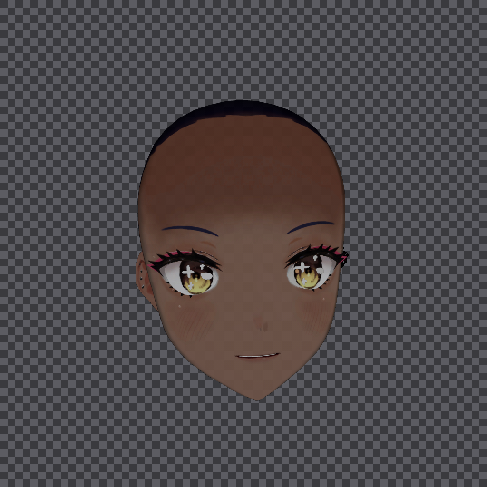
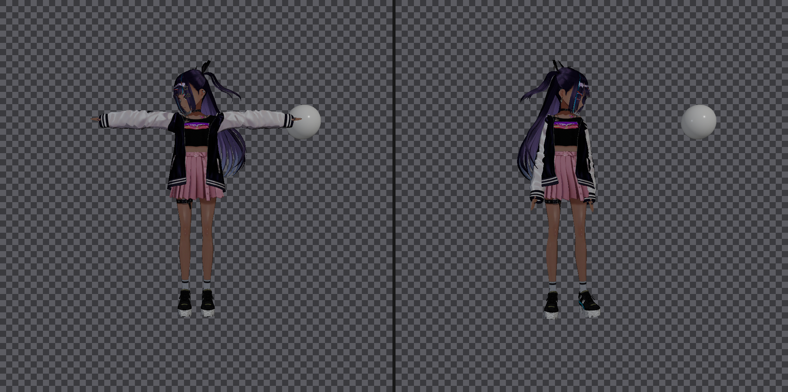
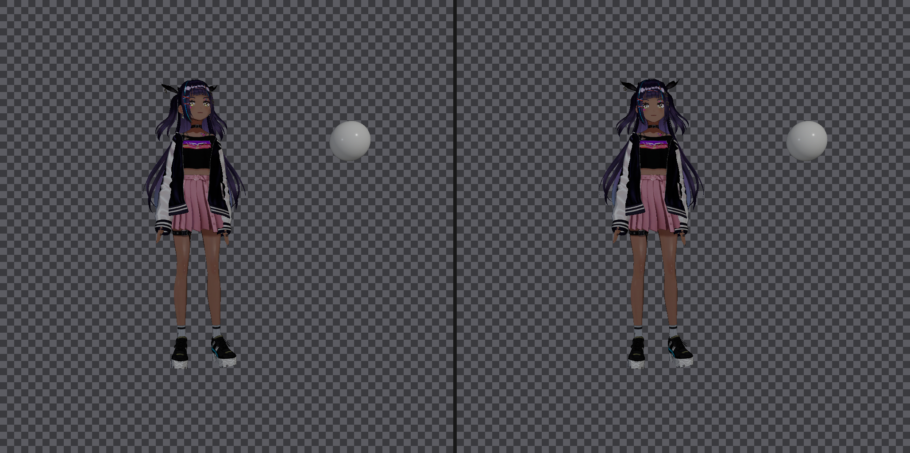

# VRM avatar over the Windows desktop, using a WickedEngine stencil mask

**Prototype result: the approach works, and the overlay is running.**

1. `alphaMode=BLEND` facial materials survive the stencil mask — every visible avatar
   pixel is captured, with zero dropped (§2).
2. A VRM avatar stands on the Windows desktop with no window, no chrome and a fully
   transparent background, animating from a `.vrma` idle loop (§6, §7).
3. The avatar looks at whoever is watching, which turned out to need an explicit fix
   rather than being the default (§8).

Nothing in the WickedEngine checkout was modified. §9 shows how that is verified.

---

## 1. The question

Render a VRM avatar with WickedEngine, derive an alpha mask from the stencil buffer, and
composite the result over the Windows desktop. The specific risk being tested:

> Blended geometry normally does not write depth or stencil. If that is true here, the
> `alphaMode=BLEND` facial materials — eyelashes, brows, eye highlights, iris — would be
> missing from the mask, and the desktop would show through the face as transparent holes.

## 2. The answer

**They survive, and nothing is dropped.**

Two independent lines of evidence.

### 2.1 Measured

`tools/compare_mask.py` recovers the avatar's true screen-space footprint by differencing
two frames rendered through the identical code path — one with the avatar, one with every
object hidden. That footprint owes nothing to the stencil buffer. Comparing it against the
mask gives:

| capture | `eps` | avatar footprint | mask coverage | **recall** | precision |
|---|---|---|---|---|---|
| whole body, front, MSAA 4 | 6 | 74,288 px | 88,814 px | **100.00%** | 83.64% |
| whole body, front, MSAA 4 | 0 | 85,463 px | 88,814 px | **100.00%** | 96.23% |
| face mesh isolated, MSAA 4 | 6 | 216,631 px | 218,611 px | **100.00%** | 99.09% |
| face mesh isolated, MSAA 4 | 0 | 218,341 px | 218,611 px | **100.00%** | 99.88% |

**Recall 100.00% — zero missed pixels — in every configuration**, at every colour
threshold including `eps=0`. Recall is the number that matters: nothing the avatar
contributes is clipped out of the mask. `eps` is the per-channel colour change at which a
pixel counts as "avatar" in the ground-truth frame; it is a CLI argument precisely so both
ends of the range can be reported, because the headline precision figure moves a lot
between them while recall does not move at all.

The `face` capture is the decisive one. `mesh[0]` has exactly 8 subsets and the model has
exactly 8 face materials, so `mesh[0]` *is* the face mesh — and it contains all five BLEND
materials. Isolated and composited over a checkerboard, the eyebrow, eyelash, eyeliner,
iris and eye highlight are all present with **zero magenta** (magenta = unmasked):



The failure map (`docs/05-face-mask-failure-map.png`, magnified head band) is grey
everywhere it should be — grey is agreement. Red would be avatar pixels the mask dropped;
there are none.

The lower precision on the full body is an artefact of the ground-truth threshold, not of
the mask: the model's dark navy jacket and black shoes render below the `eps=6`
colour-difference threshold against a black background, so they are counted as "mask
without avatar". At `eps=0` body precision rises from 83.64% to 96.23% — and recall stays
at 100.00%.

### 2.2 Read from the engine source

`wiRenderer.cpp:1998-2007`:

```cpp
case RENDERPASS_MAIN:
    if (blendMode == BLENDMODE_ADDITIVE)
        desc.dss = &depthStencils[DSSTYPE_DEPTHREAD];        // stencil_enable = false
    else
        desc.dss = &depthStencils[transparency ? DSSTYPE_TRANSPARENT : DSSTYPE_DEPTHREADEQUAL];
    break;
```

`DSSTYPE_TRANSPARENT` is built at `wiRenderer.cpp:2396-2415` as a copy of `DSSTYPE_DEFAULT`
with **only `depth_func` changed** (GREATER → GREATER_EQUAL). It therefore inherits:

```
stencil_enable        = true
stencil_func          = ALWAYS
stencil_pass_op       = REPLACE      <-- writes the reference value
stencil_write_mask    = 0xFF
```

So in WickedEngine, alpha-blended geometry **does** write the stencil buffer in the main
pass. Only `BLENDMODE_ADDITIVE` objects skip it (`DSSTYPE_DEPTHREAD` has
`stencil_enable = false`) — a real caveat for the overlay, but not one this avatar hits.

## 3. What was built

`C:/Users/PC/Documents/VRMPet` — a CMake project that consumes the engine checkout
**read-only**. No file inside `WickedEngine/` was modified.

| file | role |
|---|---|
| `CMakeLists.txt` | builds WickedEngine as a subproject with every editor/sample/test option forced OFF, then the `VRMPet` exe; stages `assets/` next to it |
| `src/main.cpp` | the whole tool: capture mode, overlay mode, VRMA retargeting, look-at |
| `build.sh` | MSVC + Ninja build, toolchain mirrored from `RoguelikeGame/build_output.sh` |
| `assets/AvatarSample_B.vrm` | the avatar — an input, tracked |
| `assets/idle_loop.vrma` | the idle animation — an input, tracked |
| `third_party/wicked_importer/` | verbatim copy of `Editor/ModelImporter_GLTF.cpp` + a `stdafx.h` stub |
| `.gitignore`, `.gitattributes` | the second one keeps `core.autocrlf` from breaking §4.4's hash |
| `tools/inspect_vrm.py` | stdlib-only GLB parser (extensions, materials, alphaMode, spring bones) |
| `tools/analyze_mask.py` | alpha histogram, silhouette bbox, checkerboard composites |
| `tools/compare_mask.py` | mask vs. ground-truth footprint: recall, precision, failure maps |
| `tools/dump_vrma.py` | `.vrma` node hierarchy, humanoid bone map, animation channels |
| `tools/dump_vrma_rotations.py` | per-channel rotation amplitude, and which channels survive retargeting |
| `tools/side_by_side.py` | composites two RGBA captures side by side for eyeballing |
| `tools/grab_desktop.ps1` | captures the real desktop, the only way to see a click-through overlay |
| `tools/crop_overlay.py` | cuts the overlay's window region out of a desktop grab |
| `tools/screen_geometry.py` | reports virtual-screen vs. work-area origin — see §6.2 |

Run:

```bash
./build.sh
cd build/run

# Overlay: avatar on the desktop, idle loop, looking at you. No arguments needed.
./VRMPet.exe overlay

# Overlay, explicit, 45 s then quit (0 = run until Ctrl+Shift+Q).
./VRMPet.exe overlay assets/AvatarSample_B.vrm 180 4 45

# Capture mode: PNGs for analysis.
./VRMPet.exe out/body assets/AvatarSample_B.vrm 180 -1 -1 4   # whole body, front, MSAA 4
./VRMPet.exe out/face assets/AvatarSample_B.vrm 180  0  0 4   # face mesh only, close-up
```

Capture args: `out-dir`, `model.vrm`, `azimuth-deg`, `focus-mesh` (-1 = whole body),
`isolate-mesh` (-1 = all), `msaa`, `anim.vrma`.
Overlay args: `overlay`, `model.vrm`, `azimuth-deg`, `msaa`, `seconds`, `anim.vrma`.

Capture mode writes `color.png`, `mask_default.png` (stencil != 0), `mask_user.png` (user
stencil ref 1), `mask_nostencil.png` (stencil ALWAYS — the full frame), `background.png`
(all objects hidden) and `engine.log`.

A bare `lookat` / `nolookat` token anywhere on the command line forces the head solver on
or off. A `-` or `none` animation path disables the animation.

## 4. Engine findings worth keeping

### 4.1 A bare `RenderPath3D` renders nothing — the projection is NaN

This cost the most time and is not obvious.

`RenderPath3D::camera` points at the global `wi::scene::GetCamera()`
(`wiRenderPath3D.h:190`), and the render path only ever writes `camera->width/height` into
it (`ResizeBuffers`, `Render`). Nothing in the render path calls `CreatePerspective()` —
establishing the projection is left to the host; the Editor does it from its camera window.

In this build the global camera reads as **all zeros**, so `zNearP == zFarP == 0` and
`XMMatrixPerspectiveFovLH(fov, aspect, 0, 0)` computes `0/0` → an all-NaN projection →
degenerate frustum → **every object culled, empty frame, empty mask.**

Probes in `Initialize()` pin it down:

```
probe local ctor           near=0.1000 far=5000.0000 fov=1.0472 sizeof=1472
probe boot (pre-engine)    near=0.0000 far=0.0000   fov=0.0000
probe pre-path global cam  near=0.0000 far=0.0000   fov=0.0000
probe post-path path cam   near=0.0000 far=0.0000   fov=0.0000  same_object=1
```

A stack-constructed `CameraComponent{}` gets the documented defaults correctly, so the
header is fine. The function-local static behind the `inline GetCamera()` is
zero-initialised and its default member initialisers never run. It is zero as the very
first thing `wWinMain` does, so nothing in the engine zeroes it — it is a
static-initialisation problem in this static-library build.

**Workaround (`ApplyProjection()` in `src/main.cpp`): call `cam.CreatePerspective()` every
frame.** Note `CameraComponent::At` is a normalised *forward direction*, not a look-at
point — it feeds `XMMatrixLookToLH(eye, direction, up)`.

### 4.2 Capture timing

`Application::Run()` is `PreUpdate → FixedUpdate → Update → Render`, so a capture taken
from `Update()` reflects the **previous** frame. `CreateScreenshotWithAlphaBackground()`
does not re-render: it re-draws `GetLastPostprocessRT()` through a stencil test against the
existing depth-stencil buffer. The state machine therefore tags objects one frame and
captures the next.

`Run()` also returns early when `!is_window_active && !alwaysactive`, so a background
launch never renders — the tool sets `is_window_active = true`.

### 4.3 MSAA gives antialiased mask edges

The stencil test is evaluated per sample, and `CreateScreenshotWithAlphaBackground()`
resolves a multisampled target. With `path->setMSAASampleCount(4)` the mask stops being
binary: the face capture has **1,213 partially transparent pixels** at levels 64 / 127 /
191 — exactly 1/4, 2/4 and 3/4 sample coverage — and the body capture has 3,603. Without
MSAA the mask is strictly 0 or 255 and the composite has hard, jagged edges. This matters
for a desktop overlay, and costs one line.

### 4.4 The VRM importer is Editor-only

`wi::scene::LoadModel()` reads only the WickedEngine Archive format — pointed at a `.vrm`
it reports *"The archive version (9769872487) is higher than the program's (93)"*, because
it is reading the GLB magic `glTF` as a version number. There is no glTF/VRM importer in
the library.

Rather than patch the engine (excluded by the constraint), `Editor/ModelImporter_GLTF.cpp`
is vendored **byte-for-byte** (sha256 `12c6bb7c…88293`, re-verified against the checkout)
and called directly. Its `#include "stdafx.h"` resolves to a local stub that omits
`Editor.h`, avoiding the whole editor dependency. Compiles with `/bigobj`.

### 4.5 The assets

`AvatarSample_B.vrm` — VRoid Studio 1.22.0, VRM 1.0, **54 humanoid bones**. Imported as
3 objects / 3 meshes / 18 materials / 1 humanoid / **80 springs**.

- `mesh[0]` **face**, 8 subsets, aabb y 1.286…1.501
- `mesh[1]` **body**, 4 subsets, aabb y 0.000…1.508
- `mesh[2]` **hair**, 6 subsets, aabb y 0.741…1.580

All 18 materials are MToon: **5 BLEND** (`EyeIris`, `EyeHighlight`, `FaceBrow`,
`FaceEyelash`, `FaceEyeline`), **13 MASK**, 0 OPAQUE. All six hair materials are MASK.

The hair and skirt **are** spring-simulated: `VRMC_springBone` declares 22 springs, 80
joints, 28 colliders and 12 collider groups, and the engine creates one `SpringComponent`
per joint — which is where the `springs=80` in the import log comes from. (An earlier
version of this report claimed the opposite. The bug was in `tools/inspect_vrm.py`, which
read the draft-era key `springBones`; the released VRM 1.0 spec calls the array `springs`.
The inspector now reads both and prints which one it found.) This matters for the overlay:
the hair visibly lags and settles as the body moves.

`idle_loop.vrma` — VRM Animation 1.0, exported by `THREE.GLTFExporter`. 33 nodes, no
meshes, no materials, 28 channels over 22 humanoid bones, 0 expressions, 10.375 s long,
250 keyframes. §7 covers what it takes to play it on this avatar.

## 5. Desktop transparency — where the boundary is

WickedEngine **cannot** present a transparent window. `GraphicsDevice_DX12::CreateSwapChain`
uses `CreateSwapChainForHwnd` with `DXGI_SWAP_EFFECT_FLIP_DISCARD` and hardcodes
`DXGI_ALPHA_MODE_IGNORE`; `SwapChainDesc` has no transparency field; nothing touches
`WS_EX_LAYERED` or DirectComposition. Making the engine's own swap chain transparent would
require patching it.

That is why this tool takes the other route: **render offscreen, extract alpha from the
stencil buffer, composite in a separate window.** The mask is produced without any engine
modification, so the constraint holds.

## 6. The overlay

### 6.1 How it works

The engine renders into a hidden `WS_POPUP` window at 1024×1024 that is never shown.
`Application::onFrameComplete` — a public `std::function<void()>` hook the engine calls
after `Present`, with the GPU idle and no render pass open — is the one safe place to touch
the captured textures, so that is where the readback lives.

Each frame:

1. `RenderPath3D::CreateScreenshotWithAlphaBackground(STENCILREF_EMPTY, STENCILMODE_NOT,
   STENCILREFMODE_ALL)` — keeps every pixel the scene rasterised and drops the cleared sky.
2. `wi::helper::saveTextureToMemory()` reads it back as tightly packed RGBA8.
3. The avatar's box is cropped out, **premultiplied**, and written as BGRA into a
   `CreateDIBSection` bitmap. `UpdateLayeredWindow` with `AC_SRC_ALPHA` requires the colour
   channels to already be multiplied by alpha; skipping this step gives a halo.
4. `UpdateLayeredWindow(hwnd, …, ULW_ALPHA)`.

The window itself:

```
WS_POPUP            no caption, no border, no chrome at all
WS_EX_LAYERED       required for UpdateLayeredWindow (per-pixel alpha)
WS_EX_TRANSPARENT   mouse input falls through to whatever is underneath
WS_EX_TOOLWINDOW    keeps it out of the taskbar and Alt+Tab
WS_EX_NOACTIVATE    never steals focus from the app you are working in
WS_EX_TOPMOST       floats above other windows
```

`WM_NCHITTEST` also returns `HTTRANSPARENT` as belt and braces. `Ctrl+Shift+Q`
(`RegisterHotKey`) quits — the overlay has no taskbar button and is click-through, so
without it there would be no way to close it.

### 6.2 Sizing the window, and why it is padded

The window is sized once, to the avatar's tight alpha box plus 40 px, and placed at the
bottom-right of `SPI_GETWORKAREA`. Because the idle loop sways the body, the box measured
over the first few settled frames is not necessarily the box for the whole 10.4 s loop, so
every 60 frames the tool re-measures and logs the result:

```
overlay window 329x768 at 1591,282  (work area 1920x1050, crop from 279,150, 40 px pad)
crop box 329x768 at 279,150 still contains the character (37 px of margin)
crop box 329x768 at 279,150 still contains the character (28 px of margin)
```

The tightest approach over a 70 s run leaves **28 px** of margin — the padding is
sufficient, and that is measured rather than assumed. Had it gone negative, the log line
would have said so by how much.

### 6.3 Verification

An overlay has no window to screenshot, so verification means grabbing the real desktop
with `tools/grab_desktop.ps1` and looking. One trap: that grab covers the whole **virtual
screen**, while `SPI_GETWORKAREA` reports the **primary** monitor. On this machine the
virtual screen is 7680×1970 starting at y = −890, so the window at work-area `(1591, 282)`
is at virtual `(1591, 1172)`. `tools/screen_geometry.py` prints both. Cropping at the
work-area coordinate gives a black rectangle and a false negative.

Measured on the real desktop:

- **60.0 fps sustained** across a 70 s run (every 5 s block reported 300–301 frames).
- Window 329×768 at (1591, 282), all six extended styles present, `WS_CAPTION` absent,
  `IsWindowVisible` true.
- The character stands over a terminal and a chat window with their text readable through
  her, no chrome, no background.
- Memory flat over the run.

Two grabs from the same run, 7 s apart, cropped to the overlay window, show her facing the
viewer with the desktop showing through and the head and shoulders having moved.

Those grabs are deliberately **not** kept in the repository. A desktop capture contains
whatever else happened to be on screen at the time, which is not this project's to publish,
so `docs/` holds rendered engine output only. `tools/grab_desktop.ps1` regenerates a grab on
demand and `tools/crop_overlay.py` cuts the window region out of it — see §6.2 for the
virtual-screen offset that crop needs.

## 7. Playing the idle loop

### 7.1 A `.vrma` is not an animation for the avatar

`idle_loop.vrma` carries its own skeleton: 33 nodes, all with **identity rotations** and
translations in centimetres, under a root node scaled 0.01. The avatar is a metre-scale rig
with anatomical bone orientations. Playing the file's animation directly would animate
nodes nobody can see.

The VRM spec's answer, and the engine's, is to match bones by **identity, not by name**.
`Scene::RetargetAnimation(dst, src, bake_data, src_scene)` (`wiScene.cpp:9170`) walks every
source channel whose target is a humanoid bone, matches it through
`HumanoidComponent::bones[]` — the VRM spec's own bone index — and records the rest-pose
offset between the two skeletons:

```
dstRelativeMatrix      = dstBoneWorld * inverse(srcBoneWorld)
srcRelativeParentMatrix = srcBoneParentWorld * inverse(dstBoneParentWorld)
```

At runtime each keyframe is pushed through that offset and decomposed. The maths checks out
at the identity: substituting the source's rest local transform gives back exactly
`Local_dst_rest`, so the rest pose maps to the rest pose. Angles are preserved under the
conjugation, which is why a 77° upper-arm rotation in the source comes out as 77° in the
destination even though the two rigs share no axis convention.

The VRMA is imported into a **throwaway `Scene`**, for three reasons: its own
`HumanoidComponent` would otherwise be a second humanoid in the main scene,
indistinguishable from the avatar's; its 33 nodes and 0.01 root scale would pollute the
scene the stencil mask is computed from; and `bake_data=true` copies the retargeted
keyframes into the main scene, so the scratch scene can be destroyed immediately.

Result, from `engine.log`:

```
retargeting 'animation'  bones_in_common=22/55  channels=28
    dropped=6 (torso_1, torso_3, torso_5, torso_6, neck_2, head)  length=10.3751s
animation playing - 22 channels retargeted onto 22 samplers, looped over 10.3751s
```

### 7.2 The six dropped channels, and the head

All 22 humanoid bones matched. The six dropped channels target nodes that are **not** in
the file's `humanBones` map, so there is no bone identity to match on. `tools/dump_vrma.py`
shows why — the file is authored on a finer skeleton than the humanoid spec names:

```
torso_1  torso_2(spine)  torso_3  torso_4(chest)  torso_5  torso_6  torso_7(upperChest)
neck_1(neck)  neck_2  head  ENDSITE
```

`spine`, `chest` and `upperChest` are mapped, so `torso_1/3/5/6` are the extra segments
between them. `neck` maps to `neck_1`, and `neck_2` is an extra segment. three-vrm's
`VRMAnimationLoader` drops exactly the same channels.

The last one is the interesting one: the file maps **`head` to node 0, a leaf end-site**,
not to node 1, which is the node actually named `head` and actually animated.
`tools/dump_vrma_rotations.py` makes the consequence concrete:

| node | bone | max rotation | kept |
|---|---|---|---|
| `neck_1` | `neck` | 6.9° | yes |
| `neck_2` | — | 4.5° | **dropped** |
| `head` | — | 3.8° | **dropped** |
| `l_up_arm` | `leftUpperArm` | 77.0° | yes |
| `r_up_arm` | `rightUpperArm` | 75.9° | yes |

So the head's own 3.8° is lost. In an idle loop that is not a big loss — the arms carry the
motion — but it does mean the head holds the model's rest orientation relative to the neck
and cannot counter-rotate. It is a property of the asset, not of the retarget: a `.vrma`
that maps `head` to the animated node would retarget it like any other bone.

### 7.3 Verifying the retarget is correct, not merely active

"Something moved" is not evidence of a correct retarget. A wrong scale or a mismatched
bone would show up as a squashed or gigantic body. Comparing the bind pose against the
retargeted pose at the same azimuth, the silhouette bbox:

| | bbox | coverage |
|---|---|---|
| bind pose | x 130…773, y 167…802 (644 × 636) | 7.94% |
| idle retargeted | x 130…698, y 167…799 (569 × 633) | 6.61% |

The vertical extent is unchanged — head at y 167 in both, feet at 802 vs 799 — so the
skeleton is preserved and the feet stay on the ground. Only the width changes, from 644 px
to 569 px: the arms come down out of the bind pose's A-pose into a natural idle stance.
Coverage falls by 17%, which is exactly the arms tucking in. That is the signature of a
correct retarget.

Front view, bind pose on the left, retargeted idle on the right:



Same comparison from behind (`docs/02-bind-vs-idle-back.png`). The light sphere is the
stencil control probe, which capture mode adds and overlay mode does not.

## 8. Why the avatar was not looking at the camera

Worth its own section, because the cause is invisible in every log and every API return
value.

**The cause: WickedEngine's humanoid look-at solver is enabled by default and aimed at the
world origin.**

`HumanoidComponent::_flags` is initialised to `LOOKAT`, and `HumanoidComponent::lookAt`
defaults to `{}` — the point `(0, 0, 0)`, which is down at the character's feet. The solver
in `Scene::Update` (`wiScene.cpp:3588-3700`) reads:

```cpp
if (humanoid.IsLookAtEnabled())      // true by default
{
    const XMVECTOR TARGET = XMVector3Normalize(
        XMVector3TransformNormal(XMLoadFloat3(&humanoid.lookAt) - P, HeadInverseW));
    ...
    Q = XMQuaternionNormalize(XMQuaternionRotationRollPitchYaw(
        angle_vertical, angle_horizontal, 0));
}
```

The `lookAtEntity != INVALID_ENTITY` check that appears just above only gates whether
`humanoid.lookAt` gets *refreshed from an entity*. The rotation itself runs whenever the
flag is set. So out of the box, every frame, the head and both eyes are rotated to stare at
the world origin, clamped against `head_rotation_max` (60° yaw, 30° pitch) and eased in at
`head_rotation_speed`.

Nothing errors. Nothing is logged. The pose just comes out wrong, and because the head is
clamped to the maximum, it looks like a deliberate tilt rather than a bug.

**Measuring it.** Guessing from a screenshot is not good enough — the head is mostly hair.
The diagnostic in `DumpSceneState()` logs the head's world basis and the two eye bone
positions, since the right-eye → left-eye vector is the head's lateral axis and is
unambiguous. Comparing the head's lateral axis against the neck's:

| | head vs. neck |
|---|---|
| bind pose, solver on (aimed at the origin) | **54.8°** |
| animated, solver on (aimed at the origin) | **63.2°** |
| bind pose, solver off | **5.9°** |
| animated, solver off | **5.8°** |

**Fix.** The tool now always aims the solver deliberately. In capture mode it is off — the
head follows the neck, which is what the retargeted animation expects. In overlay mode
`AimLookAt()` sets `humanoid.lookAt` to the camera's eye position every frame, so the pet
watches whoever is looking at the screen. Head yaw measured against the camera direction:

| animated pose | head yaw from facing the camera |
|---|---|
| solver off | 16.7° |
| solver aimed at the camera | **5.9°** |



`AimLookAt()` has to run *before* `wi::Application::Update()`, because that is what steps
the scene and the solver reads `humanoid.lookAt` while it does.

Two footnotes worth recording, because both cost time:

- The engine's `default_facing` heuristic is **not** the problem here. It comes out as −1
  for this avatar, which is correct: the head bone's local +Z points backwards for this
  rig, and the solver's `FORWARD = (0, 0, default_facing)` therefore lands on the facing
  direction. Worth checking before blaming it.
- An early attempt to test the solver aimed it at a camera framed on the face mesh, which
  put the camera 0.34 m from the face. At that distance the solver made the yaw *worse*
  (16.7° → 28.4°). With the real ~2.1 m framing it makes it better (16.7° → 5.9°). The
  measurement was fine; the test setup was not.

## 9. Verifying the read-only constraint

```
$ sha256sum WickedEngine/Editor/ModelImporter_GLTF.cpp
12c6bb7c5e98f2967f303750dc4f8f04068d11dacda1275f5a26f57042e88293

$ sha256sum VRMPet/third_party/wicked_importer/ModelImporter_GLTF.cpp
12c6bb7c5e98f2967f303750dc4f8f04068d11dacda1275f5a26f57042e88293

$ find WickedEngine -newermt <start of work> -type f
(nothing)
```

The vendored copy is still byte-for-byte the engine's, and nothing in the checkout has been
written to since. `.gitattributes` pins `-text` on that directory so a clone with
`core.autocrlf=true` — the Git for Windows default — cannot silently break the hash.

## 10. Limitations and next steps

Working: offscreen render, stencil-derived alpha mask, correct treatment of BLEND
materials, antialiased edges via MSAA, the layered click-through overlay at 60 fps, VRMA
retargeting onto the avatar's skeleton, and look-at.

Known limits:

1. **Per-frame cost.** Each frame allocates and reads back a 1024×1024 RGBA texture on the
   CPU, then copies the crop into a DIB. It holds 60 fps here, but a real implementation
   should keep this on the GPU — a DirectComposition visual with a premultiplied-alpha
   swap chain would also need no engine patch, since the engine's swap chain is not
   involved.
2. **The mask is a hard silhouette.** It has no notion of the avatar's own translucency — a
   semi-transparent skirt is still fully opaque in the mask. MSAA softens edges only.
3. **`BLENDMODE_ADDITIVE` materials** (glow, some effects) do not write stencil and would
   be dropped. None are present in this avatar.
4. **The window is sized once.** 40 px of padding covers the idle loop's motion with 28 px
   to spare, but a more energetic animation would need either a larger pad or a window that
   grows. The periodic re-measure logs the margin, so the failure would at least be visible.
5. **The head has no animation of its own** — see §7.2. The look-at solver in overlay mode
   covers for it, but a faithful fix means a `.vrma` that maps `head` to the animated node.
6. **The head turn is only reduced, not eliminated.** 5.9° residual, because the solver
   eases toward the target and the animation is still rotating the neck underneath it.
7. **Not built:** launching at login, a tray icon, dragging the pet, or aiming the look-at
   at the mouse cursor rather than the camera. The last one is a two-line change to
   `AimLookAt()` — `wi::input::GetMousePosition()` plus an unproject — and is the obvious
   next step for making it feel alive.

## 11. Reproduce

```bash
cd C:/Users/PC/Documents/VRMPet
./build.sh                       # ~230 TUs, incremental thereafter

# Overlay on the desktop. Ctrl+Shift+Q to quit.
cd build/run
./VRMPet.exe overlay

# The stencil-mask measurement behind §2.
cd C:/Users/PC/Documents/VRMPet
./build/run/VRMPet.exe out/body assets/AvatarSample_B.vrm 180 -1 -1 4
./build/run/VRMPet.exe out/face assets/AvatarSample_B.vrm 180  0  0 4
python tools/compare_mask.py build/run/out/body 6
python tools/compare_mask.py build/run/out/body 0
python tools/analyze_mask.py build/run/out/face

# The retargeting and look-at evidence behind §7 and §8.
python tools/dump_vrma.py assets/idle_loop.vrma
python tools/dump_vrma_rotations.py assets/idle_loop.vrma
python tools/inspect_vrm.py assets/AvatarSample_B.vrm
```

`python` must have `numpy` and `pillow`. `tools/grab_desktop.ps1` needs Windows PowerShell
and is only needed to look at the overlay.
